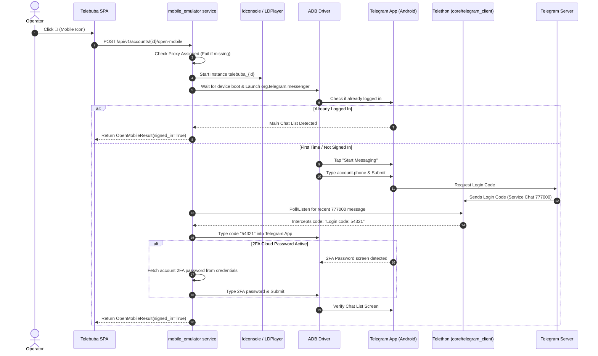

# Technical Specification: Native Mobile Device Emulation & Telegram Android Launcher

## 1. Executive Summary & Objective

### 1.1 Context
In Telebuba, accounts currently have a "Telegram Web" launcher represented by the globe icon (`AccountsTable.tsx`), triggering `/api/v1/accounts/{account_id}/open-web`. This runs an isolated desktop Chromium browser window in app mode targeting `https://web.telegram.org/k/`.

While functional, Telegram servers categorize this session as `Telegram Web (Chrome/WebK)`. For maximum account trust, anti-ban resilience, and operational fidelity, operations require an indistinguishable **native mobile session** running the **official Telegram Android APK** within a virtualized mobile environment.

### 1.2 Target Deliverable
Provide a native **Mobile Launcher** action button (📱 Smartphone icon) alongside the Globe icon on the Accounts table. Clicking this button:
1. Spawns or raises a dedicated, lightweight Android emulator instance (via LDPlayer 9 CLI or headless AVD).
2. Sets up hardware device fingerprints (IMEI, Android ID, MAC, Samsung/Pixel device profiles).
3. Binds network traffic strictly to the account's assigned proxy.
4. Executes a **Zero-Click Authentication Flow**:
   - Launches `org.telegram.messenger`.
   - Automatically inputs the account's phone number.
   - Intercepts the 5-digit verification code from Telegram's service chat (`777000`) using Telebuba's existing Telethon session.
   - Enters the code and 2FA password via ADB.
5. Surfaces a responsive, vertical smartphone window running the official Telegram app directly on the operator's desktop.
6. Automatically cleans up or suspends the instance when closed.

---

## 2. System Architecture & Layer Boundaries

The implementation strictly respects Telebuba's architectural law:
```
React SPA (Frontend)
       ↓
/api/v1/accounts/{account_id}/open-mobile (API Layer)
       ↓
services/accounts/mobile_emulator.py (Service Layer)
       ↓
core/emulator/ (Core Infrastructure Layer: CLI, ADB, Proxy Relays)
       ↓
schemas/mobile_emulator.py (Shared Pydantic Models)
```

### 2.1 File & Module Layout

```text
telebuba/
├── schemas/
│   └── mobile_emulator.py            # Pydantic contracts (OpenMobileResult, EmulatorConfig)
├── core/
│   └── emulator/
│       ├── __init__.py
│       ├── config.py                 # Paths to emulator binary, APK storage, timeout settings
│       ├── ldconsole.py              # Subprocess wrapper for ldconsole.exe (create, launch, quit)
│       ├── adb.py                    # High-level UI automation wrapper (tap, text, keycode, wait_for)
│       └── session_capture.py        # 777000 service code extractor via active Telethon client
├── services/
│   └── accounts/
│       ├── mobile_emulator.py        # Orchestrator: instance lifecycle, locks, zero-click login
│       └── __init__.py               # Re-export open_account_mobile, shutdown_mobile_emulator
├── api/
│   └── v1/
│       └── accounts.py               # POST /accounts/{account_id}/open-mobile
└── frontend/
    └── src/
        ├── shared/ui/Icon.tsx        # Add 'smartphone' icon mapping from lucide-react
        ├── shared/i18n/              # ru.json / en.json translation keys
        ├── widgets/accounts-table/   # AccountsTable.tsx mobile button next to globe
        └── pages/accounts/           # AccountsPage.tsx openMobile mutation handling
```

---

## 3. Core Engine Specification (`core/emulator/`)

### 3.1 Host Dependencies
- **Emulator Engine**: LDPlayer 9 (default path: `C:\LDPlayer\LDPlayer9\dnplayer.exe` / `ldconsole.exe`).
- **ADB Bridge**: Included with LDPlayer (`ldconsole.exe adb`) or via `adbutils` Python library.
- **Base APK**: Official Telegram Android APK placed in `data/apks/Telegram.apk`.

### 3.2 CLI Wrapper (`core/emulator/ldconsole.py`)
Provides deterministic async execution of `ldconsole.exe` commands:
- `create_instance(name: str) -> int`: Creates a fresh instance clone.
- `set_device_profile(name: str, model: str, imei: str, android_id: str, mac: str)`: Configures hardware identity.
- `set_resolution(name: str, width: int = 412, height: int = 915, dpi: int = 320)`: Compact vertical smartphone view.
- `set_resource_limits(name: str, cpus: int = 1, ram_mb: int = 1536)`: Minimized resource consumption.
- `launch_instance(name: str) -> None`: Starts the GUI window.
- `stop_instance(name: str) -> None`: Gracefully shuts down the instance.
- `is_running(name: str) -> bool`: Checks running status.

### 3.3 Network Routing & Proxy Integration
- The emulator must never route traffic through the host's direct IP.
- Traffic is routed through the account's assigned proxy:
  1. Option A (Built-in proxy): Apply proxy settings directly via ADB (`settings put global http_proxy 127.0.0.1:<relay_port>`).
  2. Option B (Dedicated proxy tool): Auto-configure Postern/Drony/LSPosed inside the template instance pointing to `LocalProxyRelay(account.proxy)`.

### 3.4 ADB UI Automation (`core/emulator/adb.py`)
Lightweight UI driver based on `adbutils`:
- `start_app(package: str = "org.telegram.messenger")`: Launches Telegram.
- `tap_element_or_coords(x: int, y: int)`: Emulates touch gestures.
- `input_text(text: str)`: Types text cleanly via ADB.
- `press_key(keycode: int)`: Sends Android key events (e.g., ENTER = 66, BACK = 4).
- `wait_for_text(expected: str, timeout: float = 15.0)`: Verifies UI transition via UIAutomator dump.

---

## 4. Service Layer: Zero-Click Login Flow (`services/accounts/mobile_emulator.py`)

### 4.1 State Machine & Locking
- An in-memory lock `_account_mobile_locks: dict[str, asyncio.Lock]` prevents concurrent launches for the same account.
- If an instance `telebuba_{account_id}` is already running, focus the window and return `{launched: True, already_running: True}`.

### 4.2 Automated Authentication Flow



---

## 5. API Layer Contract (`api/v1/accounts.py`)

### 5.1 Endpoint
`POST /api/v1/accounts/{account_id}/open-mobile`

### 5.2 Schemas (`schemas/mobile_emulator.py`)
```python
from pydantic import BaseModel, Field

class OpenMobileResult(BaseModel):
    launched: bool
    signed_in: bool
    instance_name: str
    message: str | None = None
```

### 5.3 Error Codes
- `400 NoProxyForMobileError`: Account has no assigned proxy.
- `400 EmulatorNotFoundError`: LDPlayer or ADB binary not located on host.
- `400 LoginCodeTimeoutError`: Telethon did not receive code from 777000 within 45s.
- `404 AccountNotFoundError`: Account ID does not exist.

---

## 6. Frontend UI Implementation

### 6.1 Glyph Registry (`frontend/src/shared/ui/Icon.tsx`)
Add `Smartphone` from `lucide-react`:
```typescript
import { Globe, Smartphone, ... } from 'lucide-react';

const GLYPH = {
  ...
  globe: Globe,
  smartphone: Smartphone,
  ...
} satisfies Record<string, LucideIcon>;
```

### 6.2 Table Action Column (`frontend/src/widgets/accounts-table/ui/AccountsTable.tsx`)
Place the Mobile action adjacent to the Web Globe:
```tsx
<IconButton
  size="touch"
  shape="circle"
  tone="primary"
  title={t('accounts.actions.mobile')}
  aria-label={t('accounts.actions.mobile')}
  className="md:size-icon"
  disabled={!account.proxy_id || openingMobile}
  onClick={(event) => {
    event.stopPropagation();
    onOpenMobile?.(account.account_id);
  }}
>
  {openingMobile ? <Spinner /> : <Icon name="smartphone" size={14} />}
</IconButton>
```

### 6.3 Localizations (`frontend/src/shared/i18n/`)
- `ru.json`:
  ```json
  "accounts": {
    "actions": {
      "web": "Telegram Web",
      "mobile": "Мобильный Telegram (Эмулятор)",
      "check": "Проверить сессию"
    },
    "openMobile": {
      "notSignedIn": "Не удалось войти в мобильное приложение автоматически"
    }
  }
  ```
- `en.json`:
  ```json
  "accounts": {
    "actions": {
      "web": "Telegram Web",
      "mobile": "Mobile Telegram (Emulator)",
      "check": "Check session"
    },
    "openMobile": {
      "notSignedIn": "Failed to authenticate mobile app automatically"
    }
  }
  ```

---

## 7. Implementation Checklist & Verification Gates

### Phase 1: Core Subsystem
- [ ] Create `schemas/mobile_emulator.py` with Pydantic request/response models.
- [ ] Implement `core/emulator/ldconsole.py` subprocess runner for instance lifecycle.
- [ ] Implement `core/emulator/adb.py` for UI interaction and text typing.
- [ ] Implement `core/emulator/session_capture.py` to extract 777000 verification codes from Telethon client.

### Phase 2: Service & API
- [ ] Implement `services/accounts/mobile_emulator.py` with mutex locking and Zero-Click login state machine.
- [ ] Register endpoint `POST /api/v1/accounts/{account_id}/open-mobile` in `api/v1/accounts.py`.
- [ ] Register shutdown hook in `main.py` lifespan to cleanly terminate running emulators on backend exit.

### Phase 3: Frontend Integration
- [ ] Add `smartphone` to `frontend/src/shared/ui/Icon.tsx`.
- [ ] Update `AccountsTable.tsx` and `AccountsPage.tsx` with mutation and busy-state spinners.
- [ ] Add i18n keys to `ru.json` and `en.json`.

### Phase 4: Automated Verification
- [ ] Unit tests in `tests/core/test_mobile_emulator.py` mocking `ldconsole` and `adb`.
- [ ] Unit tests for 777000 code extraction with regex boundary checks.
- [ ] Frontend Vitest in `AccountsTable.test.tsx` verifying button state with/without proxy.
- [ ] Architectural verification passing (`uv run pytest tests/test_architecture.py`).
